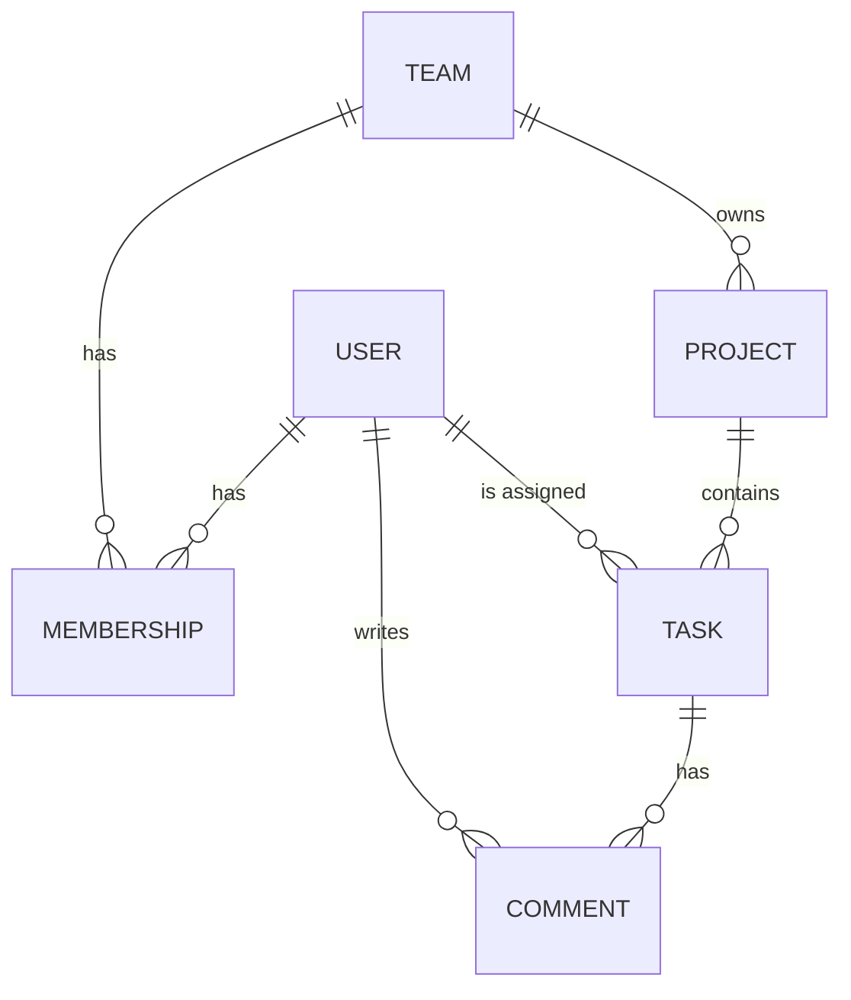

# TaskFlow API

[](https://github.com/RenanMeloo/taskflow/actions/workflows/ci.yml)

A REST API for teams to organize projects and tasks, built with Django REST Framework. It features JWT authentication, role-based permissions and team-scoped data: users only ever see the teams, projects and tasks they belong to.

## Features

- **Authentication** with JWT (access and refresh tokens), registration and profile management
- **Teams** with three roles: owner, admin and member
- **Membership management**: add and remove members through the API
- **Projects** that belong to a team
- **Tasks** with status, priority, due date and an assignee
- **Comments** on tasks
- **Filtering, search and ordering** on tasks
- **Interactive API docs** with Swagger UI and Redoc

## Tech stack

- Python 3.14, Django 6.1 and Django REST Framework
- `djangorestframework-simplejwt` for authentication
- `django-filter` for filtering
- `drf-spectacular` for OpenAPI documentation
- `pytest`, `pytest-django` and `pytest-cov` for testing
- `ruff` for linting and formatting
- GitHub Actions for continuous integration
- Docker and Docker Compose
- PostgreSQL (SQLite as a fallback for tests and quick local runs)

## Data model



A `Membership` links a user to a team with a role. A user can belong to many teams, with a different role in each one.

## Permissions

Anyone who is not a member of a team gets a `404` for its resources, as if they did not exist.

| Resource | View | Create | Edit | Delete |
|---|---|---|---|---|
| Team | Members | Any user | Owner, admin | Owner |
| Members | Members | Owner, admin | — | Owner, admin |
| Project | Members | Owner, admin | Owner, admin | Owner, admin |
| Task | Members | Members | Members | Task creator |
| Comment | Members | Members | — | — |

Additional rules:

- The user who creates a team becomes its owner
- The owner role cannot be assigned through the API, and the owner cannot be removed from the team
- A user cannot be added to the same team twice
- A task's assignee must be a member of the project's team

## API endpoints

| Method | Endpoint | Description |
|---|---|---|
| POST | `/api/auth/register/` | Register a new user |
| POST | `/api/auth/token/` | Get access and refresh tokens |
| POST | `/api/auth/token/refresh/` | Get a new access token |
| GET, PATCH | `/api/auth/profile/` | View or update your profile |
| GET, POST | `/api/teams/` | List your teams or create one |
| GET, PATCH, DELETE | `/api/teams/{id}/` | Retrieve, update or delete a team |
| GET, POST | `/api/teams/{id}/members/` | List or add team members |
| DELETE | `/api/teams/{id}/members/{user_id}/` | Remove a member |
| GET, POST | `/api/projects/` | List or create projects |
| GET, PATCH, DELETE | `/api/projects/{id}/` | Retrieve, update or delete a project |
| GET, POST | `/api/tasks/` | List or create tasks |
| GET, PATCH, DELETE | `/api/tasks/{id}/` | Retrieve, update or delete a task |
| GET, POST | `/api/tasks/{id}/comments/` | List or add comments |

### Filtering tasks

```
/api/tasks/?status=todo
/api/tasks/?project=1&priority=high
/api/tasks/?assignee=2
/api/tasks/?search=login
/api/tasks/?ordering=-due_date
```

- **Filter by:** `status`, `priority`, `assignee`, `project`, `created_by`
- **Search in:** `title`, `description`
- **Order by:** `due_date`, `created_at`, `updated_at`, `priority_level` (prefix with `-` for descending)

## Running locally

### With Docker (recommended)

You only need [Docker](https://www.docker.com/) installed.

```bash
git clone https://github.com/RenanMeloo/taskflow.git
cd taskflow

cp .env.example .env             # then set a SECRET_KEY in .env
docker compose up --build
```

This starts the API and a PostgreSQL database, and applies the migrations automatically. Database data is kept in a Docker volume, so it survives restarts.

To create an admin user:

```bash
docker compose exec web python manage.py createsuperuser
```

### Without Docker

Requires Python 3.14. Without a `DATABASE_URL`, the project uses SQLite.

```bash
git clone https://github.com/RenanMeloo/taskflow.git
cd taskflow

python -m venv .venv
source .venv/bin/activate        # Windows: .venv\Scripts\activate

pip install -r requirements.txt

cp .env.example .env             # then set a SECRET_KEY in .env
python manage.py migrate
python manage.py runserver
```

To generate a secret key:

```bash
python -c "from django.core.management.utils import get_random_secret_key; print(get_random_secret_key())"
```

The API docs will be available at:

- Swagger UI: http://127.0.0.1:8000/api/schema/swagger-ui/
- Redoc: http://127.0.0.1:8000/api/schema/redoc/

To try authenticated endpoints in Swagger, get a token from `/api/auth/token/`, click **Authorize** and paste the `access` token.

## Running tests

```bash
pytest
pytest --cov --cov-report=term-missing   # with coverage report
ruff check .                             # linting
```

Every push to `main` runs the linter and the test suite on GitHub Actions.

## Design decisions

**404 instead of 403 for non-members.** Every viewset filters its queryset by the user's memberships. Resources from other teams are not just forbidden, they are invisible, so the API does not reveal that they exist.

**Permissions split by responsibility.** The queryset decides *what a user can see*, permission classes decide *what a user can do* with an existing object, and serializers validate *the data being sent*. Creation rules live in serializers, because on a `POST` there is no object yet for a permission class to check.

**Atomic team creation.** Creating a team also creates the owner's membership. Both happen inside `transaction.atomic()`, so a team can never exist without an owner.

**Server-controlled fields.** Fields like a team's `owner`, a task's `created_by` and a comment's `author` are read-only or hidden, and are always set from the authenticated user. Clients cannot create resources on behalf of someone else.

**Database configured by environment.** The database comes from a `DATABASE_URL` variable. Docker Compose points it to PostgreSQL, while tests and CI run on SQLite without any extra setup.

**Validation that spans fields.** Checking that an assignee belongs to the project's team needs both fields, so it lives in the serializer's `validate` method. On partial updates the project falls back to the existing task's project, so the rule cannot be bypassed with a `PATCH`.

## Next steps

- Production server setup with Gunicorngit 
- Allow team owners to delete tasks whose creator has left
- Password change endpoint
- Deployment
